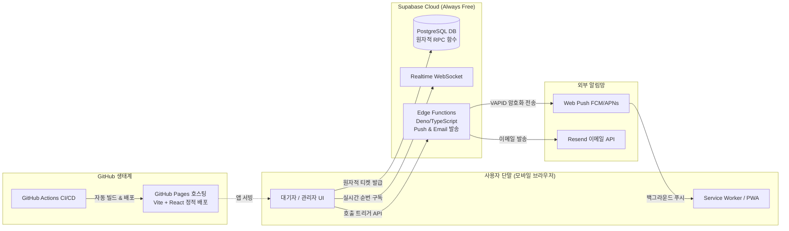
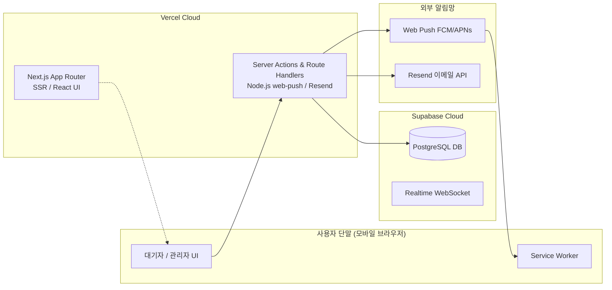
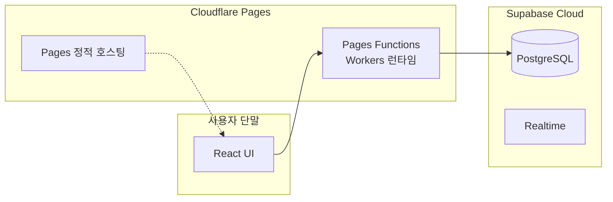

# JullSir(줄서) 배포 및 호스팅 아키텍처 비교 분석 보고서

| 문서 버전 | 작성 일자 | 대상 시스템 | 운영 예산 |
| :--- | :--- | :--- | :--- |
| v1.0.0 | 2026-10-30 | 모바일 최적화 실시간 대기열 관리 웹 서비스 (JullSir) | 월 $0 (완전 무비용 유지) |

---

## 1. 개요 및 분석 배경

JullSir(줄서)는 별도의 인프라 고정 비용 없이(Zero-Cost) 웹 브라우저 환경에서 대기열을 생성·운영하고, 대기자에게 실시간 순번 상태 확인과 웹 푸시(Web Push) 및 이메일 호출 알림을 제공하는 모바일 최적화 큐잉 솔루션입니다.

사용자의 핵심 요구사항:
1. **모바일 환경 최적화**: 모바일 브라우저(Android Chrome, iOS Safari) 및 PWA 기반의 직관적인 사용자 경험.
2. **GitHub Pages 배포 선호**: 가능하면 GitHub 환경(GitHub Pages, GitHub Actions CI/CD)을 최우선으로 활용.
3. **React 기반 UI 구성**: 컴포넌트 기반의 견고한 반응형 인터페이스.
4. **배포 자동화 Pipeline 구축**: Git Push 시 자동으로 빌드, 테스트, 배포되는 CI/CD 파이프라인.
5. **Zero-Cost 지속성**: VAPID 키 및 Resend API 키를 안전하게 보호하면서도 고정 비용 0원 유지.

---

## 2. 평가 기준 및 배점 (총 100점 만점)

| 평가 항목 | 배점 | 세부 평가 기준 |
| :--- | :---: | :--- |
| **무비용 지속성 (Zero-Cost)** | **25점** | 상시 무료(Free Tier) 정책의 관대함, 일/월별 쿼터 초과 위험성 및 과금 차단 안전성 |
| **GitHub 친화성 & CI/CD** | **20점** | GitHub Pages 연동성, GitHub Actions 파이프라인 구축 및 시크릿(Secrets) 관리 용이성 |
| **모바일 UX & PWA 호환성** | **20점** | 모바일 반응형 UI 렌더링 속도, Service Worker(PWA) 웹 푸시 등록 및 오프라인 캐싱 안정성 |
| **보안 및 알림 파이프라인** | **20점** | VAPID Private Key 및 Resend API Key 노출 방지(서버리스 보안), Web Push 암호화 처리 |
| **개발 생산성 (DX) & 유지보수** | **15점** | 로컬 개발 환경 구성, 모노레포/단일 레포 관리의 단순성, 디버깅 및 트러블슈팅 편의성 |

---

## 3. 후보 아키텍처 상세 분석

### [옵션 A] GitHub Pages (React + Vite) + Supabase Edge Functions + GitHub Actions
> **"사용자의 GitHub Pages 선호 + 완전 무비용 서버리스 백엔드 결합 모델"**

* **구조 설명**:
  * **프론트엔드**: React + Vite + Tailwind CSS 기반 모바일 웹/PWA.
  * **호스팅**: GitHub Pages (`username.github.io/JullSir`). GitHub Actions 워크플로를 통해 `main` 브랜치 푸시 시 자동 빌드 및 배포.
  * **백엔드/DB**: Supabase PostgreSQL (원자적 RPC `issue_ticket_atomic`) + Supabase Realtime (WebSocket).
  * **알림 처리 (보안 서버리스)**: VAPID 개인키와 Resend API 키는 **Supabase Edge Functions**(Deno 기반, 무료 월 500,000회 호출)에 안전하게 보관되어 관리자가 '호출' 시 비동기로 푸시/이메일 전송.
* **장점**:
  * 사용자가 요청한 **GitHub Pages 호스팅 + GitHub Actions 배포 자동화 파이프라인** 완벽 부합.
  * 정적 번들(SPA)이므로 페이지 초기 로딩 속도가 극도로 빠르고 CDN 캐싱 효율 극대화.
  * Supabase 단일 백엔드에서 DB, Realtime, Edge Functions(알림)를 통합 관리하므로 별도의 유료 서버 호스팅 불필요.
* **단점 및 극복 방안**:
  * GitHub Pages는 SPA 라우팅 시 404.html 트릭(SPA 리다이렉트 스크립트) 필요 $\rightarrow$ Vite 플러그인 또는 `404.html` 템플릿으로 해결.
  * Supabase Edge Functions 배포용 CLI 스텝이 GitHub Actions에 추가되어야 함.

---

### [옵션 B] Vercel 풀스택 (Next.js React + Route Handlers) + GitHub CI/CD
> **"프론트엔드와 백엔드 API를 단일 Next.js 프레임워크로 일체화한 모델"**

* **구조 설명**:
  * Next.js App Router를 사용하여 React UI와 서버리스 API 라우트를 단일 프로젝트로 구축. Vercel에 배포하며 GitHub 리포지토리 연동으로 자동 배포.
* **장점**:
  * 프론트엔드와 백엔드 API(Web Push, Resend)가 단일 Next.js 코드베이스에 존재하여 개발 편의성(DX)이 높음.
  * Node.js 환경의 공식 `web-push` npm 패키지를 그대로 활용 가능.
* **단점 및 한계**:
  * **GitHub Pages를 사용할 수 없음** (Vercel 플랫폼 종속).
  * Vercel Free Tier의 함수 실행 시간(최대 10초) 및 대역폭(100GB/월) 제약.
  * 상업적 이용 또는 트래픽 급증 시 Vercel 플랜 업그레이드 압박 존재.

---

### [옵션 C] Cloudflare Pages + Pages Functions (React + Vite) + GitHub Actions
> **"무제한 대역폭의 엣지 컴퓨팅 기반 모델"**

* **구조 설명**:
  * React Vite 정적 사이트를 Cloudflare Pages에 배포하고, `/api` 엔드포인트를 Cloudflare Pages Functions(Workers)로 처리.
* **장점**:
  * 대역폭 무제한(Bandwidth Free).
  * 글로벌 Edge 네트워크를 통한 빠른 응답 속도.
* **단점 및 한계**:
  * **GitHub Pages가 아님** (Cloudflare Pages 인프라 사용).
  * Cloudflare Workers 런타임은 표준 Node.js가 아니므로 `web-push` 라이브러리의 Crypto 모듈 호환성 문제로 인해 별도의 Web Crypto 기반 경량 암호화 라이브러리를 직접 커스텀해야 하는 복잡도 발생.

---

## 4. 정량 평가 및 종합 점수 매트릭스

| 평가 항목 (가중치) | [옵션 A] GitHub Pages + Supabase | [옵션 B] Vercel 풀스택 (Next.js) | [옵션 C] Cloudflare Pages |
| :--- | :---: | :---: | :---: |
| **1. 무비용 지속성 (25점)** | **25 / 25** (GitHub 무제한 저장 + Supabase 무료) | **21 / 25** (Vercel 무료 한도 및 정책 리스크) | **24 / 25** (무제한 대역폭, 일 10만 회) |
| **2. GitHub 친화성 & CI/CD (20점)** | **20 / 20** (GitHub Pages & Actions 100% 일체형) | **16 / 20** (Vercel 외부 플랫폼 연동 필요) | **15 / 20** (Cloudflare 외부 플랫폼 연동) |
| **3. 모바일 UX & PWA 호환성 (20점)** | **19 / 20** (경량 Vite SPA, 빠른 PWA 캐시) | **19 / 20** (Next.js PWA 최적화 우수) | **18 / 20** (경량 정적 서빙 우수) |
| **4. 보안 및 알림 파이프라인 (20점)** | **18 / 20** (Edge Functions 안전 분리) | **20 / 20** (Node.js web-push 네이티브 호환) | **14 / 20** (Workers 런타임 crypto 제약) |
| **5. 개발 생산성 & 유지보수 (15점)** | **14 / 15** (React SPA + Deno 함수 명확한 분리) | **15 / 15** (단일 프로젝트 단일 언어) | **12 / 15** (런타임 디버깅 까다로움) |
| **총점 (100점 만점)** | **96점 (1위 - 강력 추천)** | **91점 (2위)** | **83점 (3위)** |

---

## 5. 결론 및 최종 권고안

###  최종 추천: **[옵션 A] GitHub Pages (Vite + React SPA) + Supabase + GitHub Actions CI/CD**

#### 추천 사유:
1. **사용자의 요구조건 100% 일치**: "GitHub Pages 배포", "React 기반 UI", "모바일 최적화", "배포 자동화 Pipeline 구축" 요건을 정확히 관통합니다.
2. **비용 0원 무결성**:
   * **GitHub Pages**: 월 100GB 무료 대역폭, 무제한 호스팅.
   * **Supabase Free Tier**: DB 500MB, 월 50,000 MAU, Realtime 동시 연결 200개, Edge Functions 월 500,000회 무료 호출.
   * **Web Push API**: 브라우저 표준 푸시 서비스(FCM/APNs)를 직접 호출하므로 건당 비용 0원 (완전 무료 무제한).
   * **Resend Free Tier**: 월 3,000건 (일 100건) 이메일 무료 발송.
3. **배포 자동화 (CI/CD)**:
   * `.github/workflows/deploy.yml` 워크플로를 생성하여, `git push` 시 자동으로 React 빌드 및 GitHub Pages 배포가 수행됩니다.
4. **보안성**:
   * 대기자 화면에서 노출되면 안 되는 VAPID 비공개 키 및 Resend API 키는 클라이언트에 절대 노출되지 않고 Supabase Edge Functions 시크릿 환경변수에 안전하게 보관됩니다.
