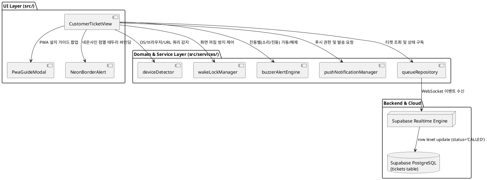
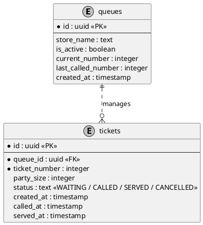
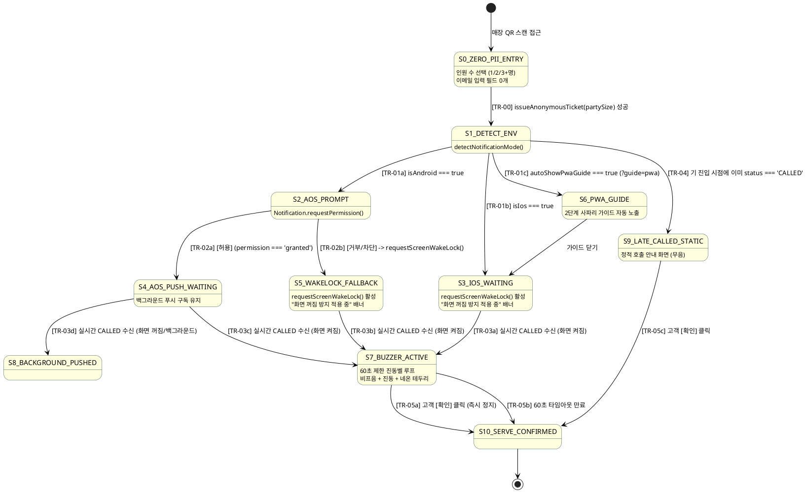

# SDS: 0-Cost 디바이스 특화 실시간 호출 알림 시스템 상세 설계서 (Queue Notification SDS)

본 문서는 1차 컨펌된 PRD([prd_queue_notification.md](../proposals/prd_queue_notification.md))를 바탕으로, 외부 유료 도메인 및 이메일 인프라를 완전히 배제하고 디바이스 환경(AOS/iOS)별로 최적화된 **0-Cost / Zero-PII 실시간 대기열 호출 알림 시스템**의 컴포넌트 구조, 데이터 모델, 함수별 세부 알고리즘, 고해상도 상태 머신, 그리고 4대 커버리지 테스트 매핑표를 정의하는 상세 설계서이다.

---

## 1. 기술 스택 및 시스템 아키텍처 구조 (Component & Data Model)

### 1.1. 적용 기술 스택 및 브라우저 API
- **프론트엔드 코어**: React 18, TypeScript 5, Vite 6, Tailwind CSS 3
- **실시간 데이터 스트림**: Supabase Realtime Client (`@supabase/supabase-js` v2) - WebSocket 기반 `tickets` 테이블 변경 이벤트 구독
- **디바이스 네이티브 웹 API**:
  - `Screen Wake Lock API`: `navigator.wakeLock.request('screen')` (화면 자동 잠금 및 절전 방지)
  - `Web Notifications API`: `Notification.requestPermission()`, `new Notification()` (AOS 푸시 알림)
  - `Vibration API`: `navigator.vibrate([500, 250, 500, 250])` (진동 패턴 생성)
  - `Web Audio API / HTML5 Audio`: 브라우저 내장 신디사이저 펄스 또는 경보 알림 비프음 루프

---

### 1.2. 모듈 및 컴포넌트 구조도 (PlantUML Component Diagram)



---

### 1.3. 데이터 모델 및 스키마 설계 (PlantUML ERD & Schema)

개인식별정보(PII) 전면 배제 원칙에 따라 `tickets` 테이블에서 `email` 필드는 완전히 무시되거나 미사용되며, 오직 `party_size`와 시스템 발급 `id`(UUID)로만 고유 식별된다.



#### 스키마 세부 필드 정의표 (`tickets`)
| 필드명 | 타입 | 제약 조건 | 설명 및 경계값 |
|---|---|---|---|
| `id` | `uuid` | PK, 기본값 `gen_random_uuid()` | 대기표 고유 난수 식별자 (URL 및 로컬스토리지 키 매핑) |
| `queue_id` | `uuid` | FK (`queues.id`) | 소속 매장 대기열 식별자 |
| `ticket_number` | `integer` | NOT NULL, `1` ~ `999` | 순차 증가 번호표 (당일 유효) |
| `party_size` | `integer` | NOT NULL, 기본값 `1`, 범위 `1` ~ `99` | 방문 인원 수 (Zero-PII 유일 입력값) |
| `status` | `text` | NOT NULL, ENUM-like | 상태: `WAITING`(대기), `CALLED`(호출), `SERVED`(입장), `CANCELLED`(취소) |
| `called_at` | `timestamp`| NULLABLE | 점주가 호출 버튼을 누른 실시간 타임스탬프 |

---

## 2. 함수 레벨 상세 설계 및 세부 알고리즘 (Function Specs & Algorithms)

### 2.1. 모듈별 함수 시그니처 및 Doxygen 대응 명세표

| 설계 ID (`SDS######`) | 소속 모듈 및 함수 시그니처 | 연관 요구조건 (`PRD`) / 시퀀스 (`SQ`) | 매핑 상태 천이 (`TR-##`) | 파라미터 타입 및 범위 (`@param`) | 반환값 (`@returns`) 및 발생 예외 (`@throws`) |
|---|---|---|---|---|---|
| **SDS26110100** | `services/queueService.ts`<br>`issueAnonymousTicket(partySize: number)` | `PRD26103100`<br>`SQ1-01`, `SQ2-01` | `TR-00` | `partySize`: 1~99 사이의 정수 | 성공 시 `Promise<Ticket>` (UUID 및 발권 순번 반환). 범위 위반 시 `ValidationError` |
| **SDS26110101** | `services/deviceDetector.ts`<br>`detectNotificationMode(ua: string, hasPwaQuery: boolean)` | `PRD26103101`, `PRD26103102`<br>`SQ1-02`, `SQ2-02` | `TR-01a` ~ `TR-01c` | `ua`: User-Agent 문자열<br>`hasPwaQuery`: boolean (`?guide=pwa`) | `{ isAndroid: boolean, isIos: boolean, isSafari: boolean, isInApp: boolean, autoShowPwaGuide: boolean }` |
| **SDS26110102** | `services/wakeLockManager.ts`<br>`requestScreenWakeLock(): Promise<boolean>` | `PRD26103102`, `PRD26103101`<br>`SQ1-04b`, `SQ2-03` | `TR-01b`, `TR-02b` | 없음 | 성공 시 `true`, 미지원/거부 시 `false` (콘솔 경고 외 크래시 없음) |
| **SDS26110103** | `services/buzzerAlertEngine.ts`<br>`startBuzzerAlarm(onTimeout?: () => void): () => void` | `PRD26103102`, `PRD26103101`<br>`SQ1-07`, `SQ2-06` | `TR-03a` ~ `TR-03d`, `TR-05a` ~ `TR-05b` | `onTimeout`: 60초 자동 만료 시 콜백 함수 | 즉시 해제 함수 `stop()` 반환 (0.1초 내 사운드·진동·타이머 정지) |
| **SDS26110104** | `services/buzzerAlertEngine.ts`<br>`shouldTriggerBuzzer(prevStatus: string, currentStatus: string, isScreenActive: boolean): boolean` | `PRD26103101`, `PRD26103102`<br>`SQ1-07`, `SQ2-05` | `TR-03a` ~ `TR-04` | `prevStatus`: 이전 티켓 상태<br>`currentStatus`: 갱신된 티켓 상태<br>`isScreenActive`: 화면 활성 여부 | `prevStatus === 'WAITING' && currentStatus === 'CALLED' && isScreenActive` 일 때만 `true` 반환 |
| **SDS26110105** | `services/notificationAlertEngine.ts`<br>`isBypassedTicket(status?: string, ticketNumber?: number, currentServingNumber?: number): boolean`<br>및 `queueRepository.callSpecificTicket(adminToken: string, ticketId: string)` | `PRD26110105`<br>`SQ4-01` ~ `SQ4-03` | `TR-06` | `status`: 티켓 상태<br>`ticketNumber`: 티켓 번호<br>`currentServingNumber`: 현재 호출 번호 | `status === 'WAITING' && currentServingNumber > ticketNumber` 일 때 `true`, 그 외 `false` 반환. 특정 티켓 호출 시 해당 티켓 `CALLED` 전이 및 번호 갱신 |

---

### 2.2. 핵심 비즈니스 알고리즘 및 결정표 (Algorithms & Decision Tables)

#### 2.2.1. [알고리즘 1] 호출 시점별 진동벨 발동 판정 결정표 (Timing Decision Table)
고객이 순번 도달 전부터 대기 화면을 켜두고 지켜보고 있었는지, 아니면 이미 호출이 끝난 뒤에 지연 접속했는지를 엄격히 판정한다:

| 규칙 번호 (Rule) | 이전 티켓 상태 (`prevStatus`) | 수신된 티켓 상태 (`currentStatus`) | 브라우저 화면 상태 (`isScreenActive`) | 진동벨 시나리오 발동 (`shouldTriggerBuzzer`) | UI 렌더링 동작 |
|---|---|---|---|---|---|
| **R-01 (실시간 정상 호출)** | `WAITING` | `CALLED` | `true` (활성 화면) | **`true` (60초 알람 발동)** | 풀스크린 네온사인 점멸 + 소리 루프 + 진동 루프 |
| **R-02 (백그라운드 실시간 호출)**| `WAITING` | `CALLED` | `false` (화면 비활성) | **`false`** | OS Web Push 배너만 발송 (AOS) |
| **R-03 (사후 지연 접속)** | `(초기 로딩 없음)` | `CALLED` | `true` | **`false` (무음 차단)** | 정적 "지금 입장해 주세요" 안내 화면 즉시 표출 |
| **R-04 (단순 새로고침/재진입)**| `CALLED` | `CALLED` | `true` | **`false` (무음 차단)** | 정적 안내 화면 유지 (알람 재발동 차단) |

#### 2.2.2. [알고리즘 2] 60초 진동벨 루프 및 자가 종료 메커니즘
```typescript
class BuzzerAlertEngine {
  private timerId: NodeJS.Timeout | null = null;
  private audioIntervalId: NodeJS.Timeout | null = null;
  private isRunning: boolean = false;

  public startBuzzerAlarm(onTimeout?: () => void): () => void {
    if (this.isRunning) return this.stop.bind(this);
    this.isRunning = true;

    // 1. Web Audio 비프음 및 진동 패턴 발동
    this.playChimeLoop();
    this.triggerVibrationLoop();

    // 2. 최대 60초(1분) 안전 타이머 기동
    this.timerId = setTimeout(() => {
      this.stop();
      if (onTimeout) onTimeout();
    }, 60000);

    return this.stop.bind(this);
  }

  public stop(): void {
    if (!this.isRunning) return;
    this.isRunning = false;
    if (this.timerId) clearTimeout(this.timerId);
    if (this.audioIntervalId) clearInterval(this.audioIntervalId);
    if (navigator.vibrate) navigator.vibrate(0); // 진동 즉시 차단
  }
}
```

#### 2.2.3. 시스템 4대 계약 (System Contracts)
1. **타이밍 계약**: 대기 상태(`WAITING`)에서 실시간 이벤트로 전이된 경우에 한해서만 진동벨이 울리며, 사후 진입 시 소리 발생은 0회여야 한다.
2. **해제 계약**: 고객이 '확인'을 누르면 100ms(0.1초) 이내에 오디오 컨텍스트가 닫히고 진동이 0으로 리셋되어야 한다.
3. **폴백 계약**: 안드로이드에서 알림 권한이 거절되더라도 즉시 Wake Lock 배너 및 진동벨 모드로 100% 매끄럽게 폴백되어야 한다.
4. **연속성 계약**: 인앱 브라우저에서 `?guide=pwa` 파라미터를 들고 사파리로 유입되면 가이드 모달 2단계가 지연 없이 열려야 한다.

#### 2.2.4. 금지 제약 (Negative Constraints 4개)
- **NC-01**: 어떠한 경우에도 외부 유료 도메인, 외부 SMS, 유료 SMTP 서버를 도입하지 않는다 (비용 0원).
- **NC-02**: 점주용 임시 Gmail 계정 생성 및 외부 이메일 API 연동 코드를 일체 포함하지 않는다.
- **NC-03**: 진동벨 알람은 60초를 초과하여 울릴 수 없으며, 사후 진입 고객에게 돌발 알람을 발생시키지 않는다.
- **NC-04**: 고객의 이메일, 전화번호, 이름 등 어떠한 개인정보도 DB에 전송하거나 저장하지 않는다.

---

## 3. 고해상도 상태 머신 설계 (PlantUML State Diagram)



---

## 4. 4대 커버리지 기반 통합 TC 매핑 매트릭스 (RTM & Coverage Matrix)

| TestCase ID | 검증 유형 (기능/상태/천이/분할) | 대상 요구조건 (`PRD`) / 설계 (`SDS`) | 매핑 시퀀스 (`SQ`) / 상태 (`TR`) | 테스트 시나리오 및 입력값 | 기대 결과 및 단언 기준 |
|---|---|---|---|---|---|
| **TST26110101** | 기능 + 분할 (EP/BVA) | `PRD26103100`<br>`SDS26110100` | `SQ1-00`<br>`TR-00` | `issueAnonymousTicket(partySize)`: `1`, `4`, `99` (유효) 및 `0`, `-1` (무효) | 유효값은 UUID 발급 성공. 경계값 위반 시 `ValidationError` 발생 |
| **TST26110102** | 기능 + 분할 | `PRD26103101`, `PRD26103102`<br>`SDS26110101` | `SQ1-02`, `SQ2-02`<br>`TR-01a` ~ `TR-01c` | Android, iOS, In-App(카톡/네이버), `?guide=pwa` User-Agent 및 쿼리 입력 | OS별 플래그 및 `autoShowPwaGuide` 정확한 boolean 반환 |
| **TST26110103** | 상태 + 천이 | `PRD26103101`<br>`SDS26110102` | `SQ1-04b`<br>`TR-02b` | 안드로이드에서 알림 권한 거부(`denied`) 시 | `requestScreenWakeLock`이 호출되어 `WAKELOCK_FALLBACK` 상태 진입 |
| **TST26110104** | 기능 + 분할 (결정표) | `PRD26103101`, `PRD26103102`<br>`SDS26110104` | `SQ1-07`, `SQ2-05`<br>`TR-03a` ~ `TR-04` | `shouldTriggerBuzzer`: (WAITING $\rightarrow$ CALLED, active=true) vs (CALLED $\rightarrow$ CALLED) vs (active=false) | 실시간 대기 중 호출만 `true`, 사후 지연 접속은 `false` 반환 |
| **TST26110105** | 상태 + 천이 | `PRD26103102`<br>`SDS26110103` | `SQ2-06`, `SQ2-08`<br>`TR-05a` | 진동벨 가동 중 고객이 '확인' 버튼 클릭 | 100ms 내 `stop()` 호출되어 사운드/진동 타이머 즉시 해제 |
| **TST26110106** | 상태 + 예외 | `PRD26103102`<br>`SDS26110103` | `SQ2-08` (else)<br>`TR-05b` | 진동벨 가동 후 60초 동안 고객 무응답 (타이머 시뮬레이션) | 60000ms 경과 즉시 `stop()` 자동 호출 및 타임아웃 콜백 트리거 |
| **TST26110107** | 기능 + 천이 | `PRD26103103`<br>`SDS26110101` | `SQ3-04`<br>`TR-01c` | URL에 `?guide=pwa` 포함하여 사파리로 진입 시 | `autoShowPwaGuide === true` 감지하여 홈화면 추가 모달 활성 플래그 세팅 |
| **TST26110108** | 기능 + 분할 | `PRD26110105`<br>`SDS26110105` | `SQ4-03`<br>`TR-06` | `isBypassedTicket`: (WAITING, 2, 5) vs (WAITING, 5, 5) vs (WAITING, 6, 5) vs (CALLED, 2, 5) | 건너뛰어진 대기 번호만 `true`, 그 외(자기 순번/뒷 순번/완료/스킵)는 `false` 반환 |
| **TST26110109** | 상태 + 천이 | `PRD26110105`<br>`SDS26110105` | `SQ4-01` ~ `SQ4-03`<br>`TR-06` | 1, 2, 3번 대기 중 3번 티켓을 `callSpecificTicket`으로 비순차 호출 | 3번은 `CALLED` 전이, `currentServingNumber = 3`, 1·2번은 `WAITING` 유지 및 `waitingCount = 2` 보존 |
