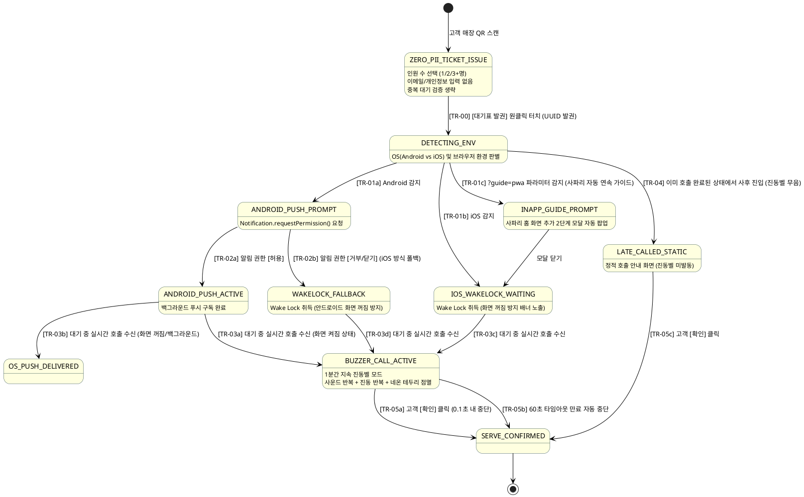
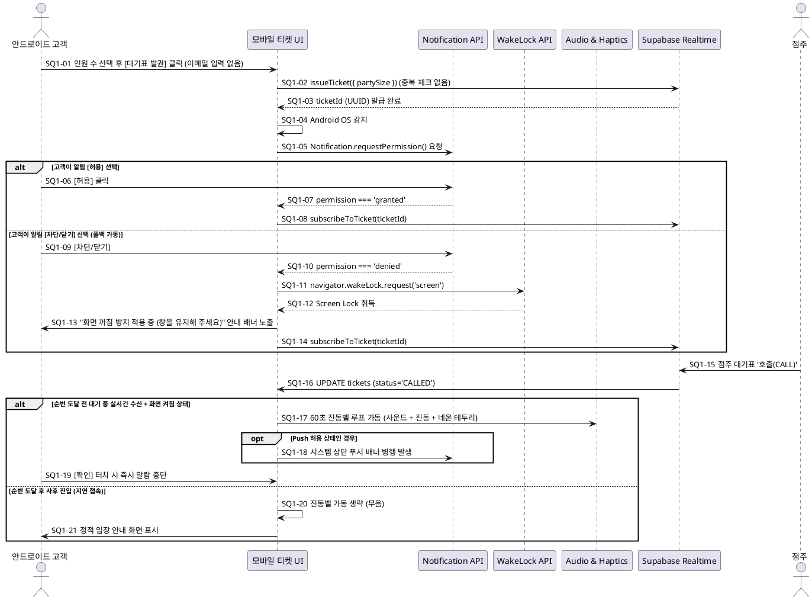
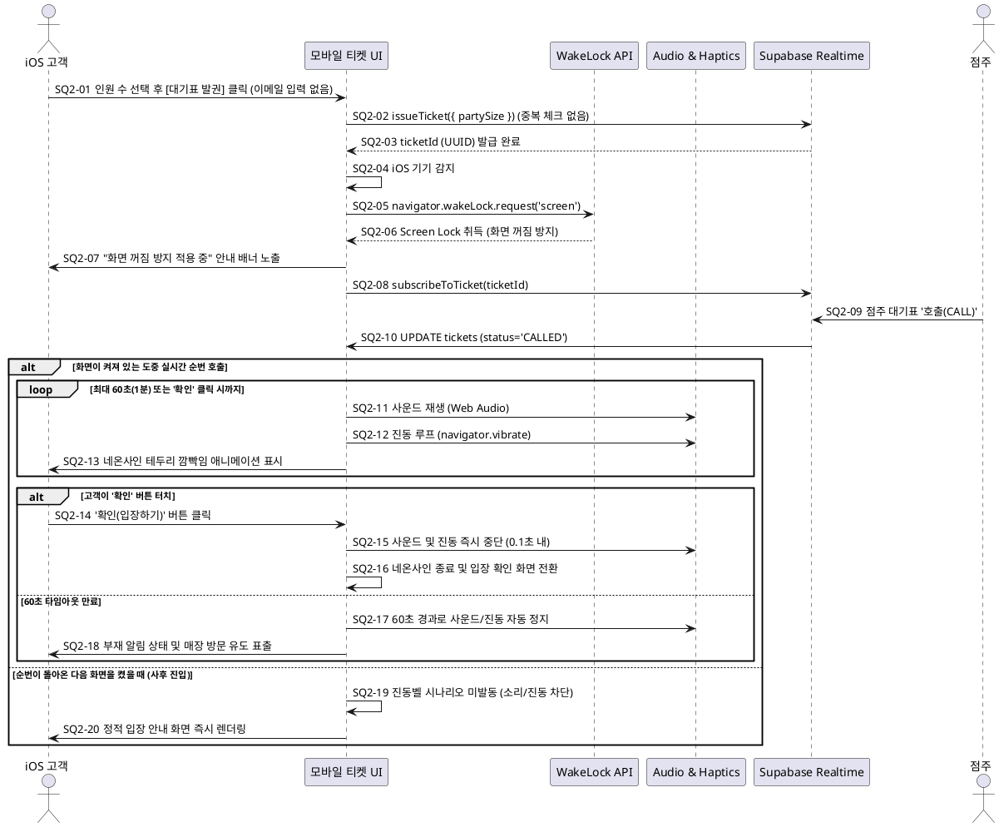
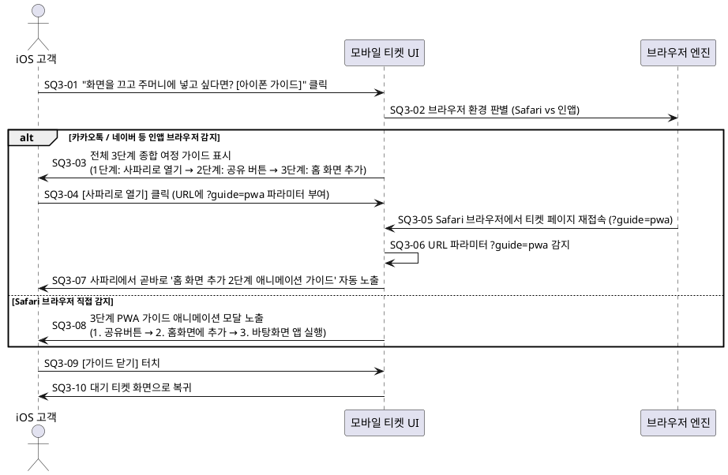
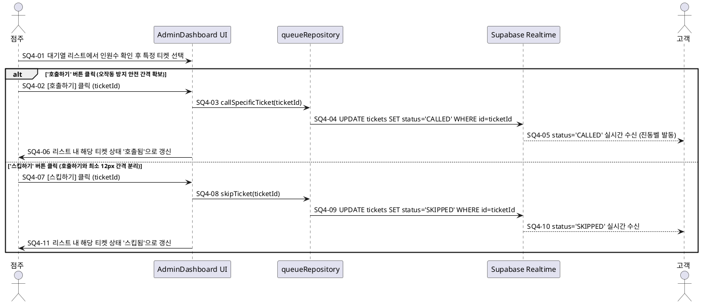

# PRD: 0-Cost 디바이스 특화 실시간 호출 알림 시스템 (Queue Notification PRD)

본 문서는 JullSir 대기열 시스템의 고객 호출 알림 기능을 **외부 유료 도메인, 유료 서버, 외부 이메일 계정 및 고객 개인정보(PII) 수집 없이 완전한 0-Cost / Zero-PII**로 제공하기 위해, 디바이스 OS(안드로이드 vs iOS) 환경에 최적화된 이원화 알림 아키텍처를 정의하는 현시점 최종 제품 기획서이다.

---

## 1. 요구조건 정의 (Feature-Centric Requirements)

### 1.1. 비즈니스 목적 및 문제 정의
1. **문제 정의 (Background & Pain Point)**:
   - 외부 이메일 발송(Resend, Mailjet 등) 방식은 유료 도메인 구매(DNS SPF/DKIM 등록)를 강제하거나, 지속적인 계정 생성 및 API 관리 부담을 초래하여 프로젝트 초기 목표인 '완전 0원(0-Cost)' 원칙을 훼손함.
   - 대기표 발권을 위해 고객에게 이메일 입력을 요구하는 것은 개인정보 유출 우려 및 발권 이탈을 유발하며, 동일 이메일 중복 체크 로직으로 인해 복잡도가 증가함.
   - iOS의 보안 정책상 일반 브라우저 탭에서는 Web Push 수신이 불가하며, 무리한 PWA 설치 강제는 대기 고객의 60% 이상 이탈을 유발함.
2. **해결 방안 (Core Value)**:
   - **개인정보 제로 (Zero-PII 익명 발권)**: 이메일, 전화번호 등 어떠한 개인정보도 수집하지 않고, 오직 '방문 인원 수' 선택 후 원클릭으로 즉시 발권. 동일 인물 중복 검증 로직도 완전 삭제하여 극도의 가벼움과 편의성 확보.
   - **안드로이드 사용자**: 브라우저 기본 Web Push API를 활용하여 1회의 원클릭 권한 획득 후 백그라운드 푸시 자동 수신. 사용자가 알림 권한을 '허용'하지 않을 경우 iOS와 100% 동일한 화면 꺼짐 방지(Screen Wake Lock) 및 진동벨 모드로 자동 폴백.
   - **iOS 및 화면 활성 사용자 공통**: 화면 꺼짐 방지(Screen Wake Lock API)를 가동하여 브라우저 활성 상태를 유지하고, 대기 도중 실시간으로 호출되었을 때 1분간 지속되는 진동벨 모드(사운드 + 진동 + 네온사인 테두리 깜빡임)로 즉시 인지 유도.
   - **호출 후 진입 제약 (Timing Constraint)**: 순번이 돌아오기 전에 사이트에 접속해 대기 중인 상태에서 실시간 호출되었을 때만 진동벨 시나리오를 발동하며, 순번이 돌아온 후 뒤늦게 사이트/앱에 진입한 경우에는 1분간의 요란한 진동벨을 울리지 않고 정적인 입장 안내 화면만 표시.
   - **아이폰 백그라운드 희망자**: 인앱 브라우저에서 사파리로의 이동 및 사파리에서의 홈 화면 추가까지 끊김 없이 안내하는 반응형 애니메이션 가이드 모달 제공.

---

### 1.2. 핵심 기능 요구조건 (Feature Specifications)

#### 1.2.1. [익명 발권] PRD26103100: 개인정보 제로(Zero-PII) 원클릭 대기표 발권 규격
1. **개인정보 입력 필드 전면 제거**:
   - 티켓 발권 화면에서 이메일 주소, 이름, 전화번호 입력 필드를 완전히 제거한다.
   - 고객은 오직 **방문 인원 수(1명, 2명, 3명 이상 등)**만 선택하고 `[대기표 발권]` 버튼을 누르면 즉시 발권된다.
2. **중복 대기 검증 로직 완전 삭제(Purge)**:
   - 과거 이메일 기반의 동일 인물 중복 등록 방지(`hasActiveTicket(email)`) 체크 로직을 데이터베이스 및 클라이언트에서 완전히 제거한다.
   - 대기표는 생성된 고유 `ticketId`(UUID)와 고객 브라우저의 로컬 세션(`localStorage`)을 통해서만 단방향 매핑된다.

#### 1.2.2. [안드로이드 환경] PRD26103101: 자동 Web Push 알림 및 권한 미허용 시 Wake Lock 폴백 규격
1. **디바이스 자동 판별 및 권한 요청**:
   - `User-Agent` 및 `navigator.userAgentData`를 분석하여 Android 기기임을 감지하면, 티켓 발권 직후 시스템 알림 허용 팝업을 자동 트리거한다 (`Notification.requestPermission()`).
2. **권한 허용 시 동작**:
   - 백그라운드 또는 화면 잠금 상태에서도 점주 호출 시 스마트폰 상단 시스템 푸시 배너 및 시스템 진동을 발생시킨다.
   - **화면 활성 시 진동벨 통합**: Web Push 권한이 허용되어 있더라도, 고객이 브라우저 화면을 켜둔 상태(`document.visibilityState === 'visible'`)에서 실시간 호출을 수신하면 상단 푸시 배너와 함께 진동벨 시나리오(사운드 + 진동 + 네온 테두리)를 동시에 동작시킨다.
3. **권한 미허용(거부/차단/닫기) 시 자동 폴백**:
   - 사용자가 알림 '허용'을 선택하지 않거나 차단한 경우, 즉시 **iOS와 동일한 화면 꺼짐 방지(Screen Wake Lock)를 가동**하고 상단에 "화면 꺼짐 방지 적용 중" 안내 배너를 띄우며, 호출 시 진동벨 시나리오로 폴백하여 알림 누락을 원천 방지한다.
4. **호출 시점 진입 제약 (Timing Constraint)**:
   - 순번이 돌아오기 전 대기 상태(`WAITING`)에서 실시간으로 `CALLED` 상태로 전환될 때만 진동벨 시나리오(소리/진동)를 발동한다.
   - 이미 순번이 호출된 상태에서 뒤늦게 접속하거나 새로고침한 경우에는 진동벨을 울리지 않고 정적 입장 안내 화면을 표시한다.

#### 1.2.3. [iOS 및 화면 활성 환경] PRD26103102: Screen Wake Lock 기반 화면 유지 및 1분 지속 진동벨 알람 규격
1. **화면 꺼짐 방지(Screen Wake Lock) 자동 적용**:
   - iOS 기기 감지 시 `navigator.wakeLock.request('screen')`를 호출하여 고객이 브라우저 창을 보고 있는 동안 화면이 자동으로 잠기거나 절전 상태로 들어가지 않도록 잠금 방지를 활성화한다.
   - 탭이 다시 활성화(`visibilitychange`)될 때마다 해제된 Wake Lock을 자동으로 재취득(Self-Recovery)한다.
2. **화면 안내 배너 노출**:
   - 티켓 상세 화면 상단에 "이 브라우저 창을 켜두시면 차례가 되었을 때 진동과 벨소리로 알려드립니다 (화면 꺼짐 방지 적용 중)" 문구를 가독성 높은 뱃지 형태로 상시 표기한다.
3. **PWA 진입자 화면 활성 시 진동벨 적용**:
   - 홈 화면에 PWA로 추가하여 접속한 고객이라도 사이트 화면이 켜져 있는 도중 순번이 돌아왔다면 동일하게 진동벨 시나리오를 적용한다.
4. **진동벨 모드 (Calling Alarm Mode) 및 타이밍 제약**:
   - **발동 조건**: 화면이 켜져 있는 도중 실시간으로 순번이 호출(`WAITING` $\rightarrow$ `CALLED`)되었을 때만 발동. 순번이 돌아온 다음 사이트 화면을 켰을 때는 진동벨을 울리지 않는다.
   - **사운드 루프**: Web Audio API 또는 HTML5 Audio를 활용하여 주의를 끄는 알림 벨소리를 2.2초 주기로 반복 재생한다.
   - **진동 루프**: `navigator.vibrate([400, 200, 400])` 패턴으로 진동을 반복 발생시킨다.
   - **네온사인 테두리 깜빡임**: 모바일 뷰포트 전체 테두리에 강렬한 네온 앰버 컬러(`ring-8 ring-amber-400 ring-offset-4`) 애니메이션 효과를 무한 점멸(`animate-pulse`)하여 시각적 인지도를 극대화한다.
   - **1분 타이머 및 확인 해제**: 고객이 화면의 '알림 소리/진동 끄기 (확인)' 버튼을 터치하기 전까지 최대 60초(1분) 동안 알람과 진동, 네온 깜빡임이 지속된다. 고객이 끄기 버튼을 누르거나 60초가 경과하면 자동으로 평시 상태로 전환된다.
5. **오디오 자동 재생 수명주기 (Autoplay Lifecycle) 보장 규격**:
   - **선행 언락 및 유휴 유지**: 발권 화면(`QueueIssue.tsx`)에서 고객이 '대기 번호표 뽑기' 버튼이나 인원수 스테퍼를 터치하는 순간 Web Audio Context를 즉시 활성화하고, 무음 루프 오실레이터/버퍼(`startKeepAlive`)를 연동하여 고객이 대기하는 동안 브라우저(Chromium/Safari)가 AudioContext를 절전 유휴 정지(`suspended`)시키지 않도록 상시 `running` 상태를 유지한다.
   - **대기 화면 사전 소리 테스트 UI**: 대기 상태(`WAITING`) 안내 배너 우측에 `[🔊 소리 테스트]` 버튼을 배치하여, 고객이 터치 시 1회 테스트 차임벨을 들으며 기기 볼륨을 점검할 수 있도록 지원함과 동시에 브라우저의 오디오 재생 권한을 사전 확보한다.
   - **화면 전환 시 즉각 자동 알람**: 실시간 호출(`CALLED`) 전이 시 사용자가 화면 빈 공간을 수동 터치할 필요 없이 즉각 차임벨이 울려야 한다.
   - **끄기 시 즉각 음소거**: 사용자가 `[🔕 알림 소리/진동 끄기 (확인)]` 버튼을 클릭하는 즉시 `MasterGainNode`를 통해 볼륨을 0으로 소거하여, 버튼 클릭 시 지연 큐잉된 사운드가 뒤늦게 방출되는 현상을 원천 방지한다.

#### 1.2.4. [iOS 환경] PRD26103103: PWA 백그라운드 푸시 설정 안내 모달 및 사파리 연계 연속성 규격
1. **가이드 진입 UI**:
   - 티켓 화면 하단에 보조 링크 버튼을 배치한다: `"화면을 끄고 주머니에 넣고 싶다면? [아이폰 백그라운드 알림 켜는 법]"`
2. **인앱 브라우저 전체 여정 표시 및 사파리 연속성 연계**:
   - **인앱 브라우저(카카오톡, 네이버, 인스타그램 등) 감지 시**:
     - 단순 '사파리로 열기'에서 끝나지 않고 사파리에서 수행해야 할 전체 여정을 종합 안내:  
       `1단계: 사파리로 열기 → 2단계: 공유 버튼 클릭 → 3단계: 홈 화면에 추가`
     - '사파리로 열기' 유도 링크에 `?guide=pwa` 파라미터를 포함하여, 사용자가 사파리로 전환하여 접속했을 때 사파리 브라우저에서 **홈 화면 추가 2단계 가이드 모달이 자동으로 즉시 열리도록** 연속 UX를 제공한다.
   - **Safari 브라우저 감지 시**:
     - 1단계: 하단 사파리 툴바의 '공유' 버튼(네모에 위쪽 화살표) 클릭.
     - 2단계: 시트 메뉴에서 '홈 화면에 추가 (+)' 선택.
     - 3단계: 바탕화면에 생성된 '줄서' 아이콘을 터치하여 실행 후 '알림 받기' 허용.
3. **인터랙티브 애니메이션 연출**:
   - SVG/CSS 기반의 가벼운 화살표 바운스 및 손가락 터치 제스처 애니메이션을 적용하여 직관적으로 이해할 수 있도록 구성한다.

#### 1.2.5. [공통 인프라] PRD26103104: 0-Cost 클라이언트 중심 실시간 알림 아키텍처 및 외부 이메일 인프라 폐기 규격
1. **외부 유료 및 계정 관리 이메일 인프라 전면 폐기**:
   - Resend API, Mailjet API, Gmail SMTP 등 외부 메일 발송 의존성을 프로덕션 호출 경로에서 완전히 분리/폐기한다.
   - 불필요해진 API 키 등록 절차를 생략하고, Supabase Realtime 구독(`tickets` 테이블 변경 이벤트)을 통해 클라이언트가 0초 지연으로 호출 이벤트를 직접 수신한다.
2. **순수 클라이언트 기반 구동**:
   - 모든 사운드 생성, 진동 트리거, Wake Lock 제어는 브라우저 네이티브 API로 처리하여 추가 서버 비용 0원을 달성한다.

#### 1.2.6. [관리자 대시보드] PRD26110105: 대기열 리스트 개별 행 '호출하기' 및 '스킵하기' 이원화 버튼 제공 규격
1. **인원수 기반 비순차 순서 전환 지원**:
   - 매장 내 테이블 상황(예: 2인석 선착착석, 4인석 대기 등)에 따라 점주가 순번에 얽매이지 않고 특정 대기표(뒷 번호)를 먼저 호출하거나 앞 번호를 건너뛸 수 있도록 지원한다.
2. **이원화 액션 버튼 배치**:
   - 대기 상태(`WAITING`)인 모든 티켓 행의 우측 액션 영역에 **'호출하기'** 버튼과 **'스킵하기'** 버튼을 둘 다 노출한다.
3. **오작동 방지 안전 간격 (Accidental Click Prevention)**:
   - 점주가 바쁜 영업 현장에서 터치 실수를 하지 않도록, 두 버튼 사이에 **충분한 물리적 간격(최소 12px / Tailwind `gap-3` 또는 `mr-3`)**을 둔다.
   - **시각적 인지성 차별화**:
     - '호출하기': Primary 컬러(Brand Blue 또는 Emerald Green, 볼드 텍스트, 확연한 확성기/벨 아이콘)로 즉시 구분.
     - '스킵하기': Muted 컬러(Slate 회색조 또는 서브 아웃라인, 경고 톤)로 배치하여 직관적으로 두 버튼의 기능이 혼동되지 않도록 설계.
   - 버튼 클릭 시 즉시 로딩 인디케이터를 활성화하여 중복 터치(Double-tap)를 방지한다.
4. **비순차 호출 시 대기 순번 및 카운트 유지 규격**:
   - 대기 중인 번호를 명시적으로 '스킵'하지 않고 뒷 번호를 먼저 호출했을 때:
     - 대기열의 `currentServingNumber`(마지막 호출 번호)는 새로 호출된 뒷 번호로 즉시 갱신한다.
     - 전체 '대기 중인 인원수'(`waitingCount`)는 건너뛰어진(스킵이나 호출이 되지 않은 `WAITING` 상태의) 앞 번호 인원을 누락 없이 포함하여 계산 및 표출한다.
5. **건너뛰어진(Bypassed) 대기 고객 화면 안내 배너 규격**:
   - 자신의 티켓 번호보다 뒷 번호가 먼저 호출되었으나 여전히 대기 상태인 티켓(`ticket.status === 'WAITING' && queue.currentServingNumber > ticket.ticketNumber`):
     - 티켓 상세 화면에 안심 안내 배너를 상시 표출한다:  
       `"인원수에 맞는 좌석이 부족하여 다음 번호가 먼저 호출될 수 있습니다 (현재 순번 유지 중)"`
     - 순번이 취소되거나 밀려난 것이 아니며 테이블 상황에 맞춘 대기 상태임을 안내하여 고객 불안을 해소한다.
6. **손님용 디스플레이(StoreDisplay) 현황 명칭 및 다음 발권 번호 표기 규격**:
   - 매장 현장 디스플레이 상단의 대기 현황 지표 카드에서 기존 '현재 입장 번호' 문구를 **'마지막 입장 번호'**로 변경하여, 현재 입장 중인 번호와 혼선을 방지하고 마지막으로 호출된 순번임을 직관적으로 인지시킨다.
   - 스마트폰 스캔용 QR 코드 상단에 **'지금 뽑으면 #{queue.lastIssuedNumber + 1}번 발급'** 강조 배지를 배치하여, 고객이 QR 코드를 스캔하기 전에 자신이 발급받을 순번을 미리 알 수 있도록 명확한 정보를 제공한다.

---

### 1.3. 비기능 요구조건 및 금지 제약 (Negative Constraints)

1. **[NC-01] 유료 인프라 및 도메인 도입 금지**:
   - 커스텀 도메인, 외부 유료 SMS/알림톡, 유료 호스팅 서버를 일체 도입하지 않으며 영구 0-Cost를 유지한다.
2. **[NC-02] 프로젝트별 계정 생성 및 외부 이메일 전송 금지**:
   - 프로젝트별 관리용 Gmail 계정을 생성하거나 외부 이메일 API를 호출하여 고객에게 이메일을 전송하는 방식을 사용하지 않는다.
3. **[NC-03] 무한 알람 지속 및 사후 진입 시 오동작 금지**:
   - 진동벨 알람은 최대 60초(1분)를 초과하여 울리지 않아야 하며, 사용자가 '확인' 버튼을 누르면 그 즉시 0.1초 내에 사운드와 진동, 네온 점멸이 중단되어야 한다.
   - 이미 순번이 지난 후 접속한 고객에게 1분간의 진동벨이 돌발적으로 울려 깜짝 놀라게 하는 오동작을 금지한다.
4. **[NC-04] 개인식별정보(PII) 수집 및 중복 체크 금지**:
   - 이메일, 휴대전화번호, 이름 등 고객의 개인식별정보를 일체 요구하거나 수집·저장하지 않는다.
   - 개인정보 기반의 중복 등록 제한을 두지 않으며, 누구나 방문 인원 수만으로 제약 없이 원클릭 발권할 수 있어야 한다.

---

## 2. 시나리오 및 상태 머신 설계 (Scenario & Diagrams)

### 2.1. 전체 라이프사이클 상태 머신 다이어그램 (PlantUML State Diagram)

---

### 2.2. 안드로이드 Web Push 및 WakeLock 폴백 시나리오 (`SQ1`)

---

### 2.3. iOS 화면 유지(Wake Lock) 및 1분 지속 진동벨 알람 시나리오 (`SQ2`)

---

### 2.4. iOS PWA 백그라운드 가이드 및 사파리 연속성 시나리오 (`SQ3`)

---

### 2.5. 점주 대기열 리스트 개별 티켓 지정 호출 및 스킵 시나리오 (`SQ4`)

---

## 3. 검증방법 설계 (Verification Strategy)

2장의 상태 머신 및 시퀀스 다이어그램에 기반하여 성공(Happy Path), 실패(Failure Path), 예외(Exception Path)를 명확히 검증하는 매트릭스를 정의한다.

| 검증 ID | 구분 | 연관 요구조건 | 대상 시퀀스 / 상태 | 검증 시나리오 및 입력 조건 | 기대 동작 및 출력 결과 |
|---|---|---|---|---|---|
| **VRF-00** | 성공 | `PRD26103100` | `SQ1-00` ~ `SQ1-01`, `TR-00` | 이메일 입력 없이 인원 수만 선택 후 발권 | 이메일 유효성 검증 및 중복 체크 없이 0.1초 내 UUID 발권 완료 |
| **VRF-01** | 성공 | `PRD26103101` | `SQ1-01` ~ `SQ1-04`, `TR-02a` | 안드로이드 기기에서 티켓 발권 후 알림 권한 허용 | `permission === 'granted'` 등록 및 호출 시 상단 푸시 발생 |
| **VRF-02** | 예외 | `PRD26103101` | `SQ1-04` (else), `TR-02b` | 안드로이드 기기에서 알림 권한 거부/닫기 | 즉시 WakeLock 가동 및 "화면 꺼짐 방지 적용 중" 배너로 폴백 |
| **VRF-03** | 성공 | `PRD26103101` | `SQ1-07`, `TR-03a` | 안드로이드 화면 켜진 상태에서 실시간 호출 수신 | 상단 푸시와 함께 진동벨(소리/진동/네온사인) 동시 발동 |
| **VRF-04** | 예외 | `PRD26103101`, `PRD26103102` | `SQ1-07` (else), `TR-04` | 호출 완료된 상태에서 뒤늦게 사이트/앱 접속 | 진동벨 시나리오 미발동(무음) 및 정적 호출 화면만 표출 |
| **VRF-05** | 성공 | `PRD26103102` | `SQ2-01` ~ `SQ2-04`, `TR-01b` | iOS Safari 기기 접속 시 | WakeLock 취득 및 "화면 꺼짐 방지 적용 중" 배너 렌더링 |
| **VRF-06** | 성공 | `PRD26103102` | `SQ2-05` ~ `SQ2-07`, `TR-03c` | 대기 화면 켜진 도중 실시간 호출(`CALLED`) 수신 | 1분간 사운드 재생, 진동 반복, 뷰포트 네온 테두리 점멸 가동 |
| **VRF-07** | 성공 | `PRD26103102` | `SQ2-08` (alt), `TR-05a` | 진동벨 알람 중 고객이 '확인' 버튼 클릭 | 즉시 0.1초 내 사운드·진동·네온사인 중단 및 입장 화면 전환 |
| **VRF-08** | 예외 | `PRD26103102` | `SQ2-08` (else), `TR-05b` | 고객이 60초 동안 '확인' 버튼을 누르지 않음 | 60초 경과 즉시 사운드/진동 자동 정지 및 부재 대기 안내 표출 |
| **VRF-09** | 성공 | `PRD26103103` | `SQ3-01` ~ `SQ3-03` | 인앱 브라우저(카카오/네이버)에서 PWA 가이드 클릭 | 전체 여정(사파리로 열기 $\rightarrow$ 홈 화면 추가) 종합 가이드 노출 |
| **VRF-10** | 성공 | `PRD26103103` | `SQ3-04` ~ `SQ3-05`, `TR-01c` | 사파리 브라우저에서 `?guide=pwa` 파라미터로 진입 시 | 사파리 진입 즉시 홈 화면 추가 2단계 가이드 모달 자동 팝업 |
| **VRF-11** | 성공 | `PRD26110105` | `SQ4-01` ~ `SQ4-03` | 대기열 리스트에서 특정 티켓의 [호출하기] 클릭 | 해당 티켓이 즉시 `CALLED` 상태로 전이되고 순번 카운트 갱신 |
| **VRF-12** | 성공 | `PRD26110105` | `SQ4-01` ~ `SQ4-03` | 대기열 리스트에서 특정 티켓의 [스킵하기] 클릭 | 해당 티켓이 즉시 `SKIPPED` 상태로 전이됨 |
| **VRF-13** | 예외 | `PRD26110105` | `SQ4-01` | '호출하기'와 '스킵하기' 버튼 간격 및 터치 영역 검증 | 최소 12px 간격(`gap-3`) 및 시각적 색상 분리로 오작동 터치 차단 |
| **VRF-14** | 성공 | `PRD26110105` | `SQ4-03`, `TR-06` | 뒷 번호 선호출 후 건너뛰어진 대기 티켓 화면 진입 | 순번 유지 안내 배너 표출 및 전체 대기 인원수 카운트 정상 유지 검증 |
| **VRF-15** | 성공 | `PRD26103102` | `SQ2-05` ~ `SQ2-07`, `TR-03c` | 발권 후 유휴 대기 도중 실시간 호출 수신 시 자동 차임벨 재생 및 알람 끄기 클릭 시 즉시 음소거 | 화면 빈 공간 수동 터치 없이도 차임벨 자동 발생 및 끄기 버튼 터치 즉시 사운드 소거(0ms 지연) |
| **VRF-16** | 성공 | `PRD26110105` | `SQ4-01` ~ `SQ4-03` | 손님용 디스플레이(StoreDisplay) 화면 진입 및 신규 발권 | '마지막 입장 번호' 라벨 표출 및 QR 코드 상단에 `지금 뽑으면 #{lastIssuedNumber + 1}번 발급` 배지 정상 표시 |
